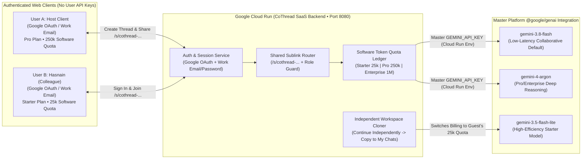
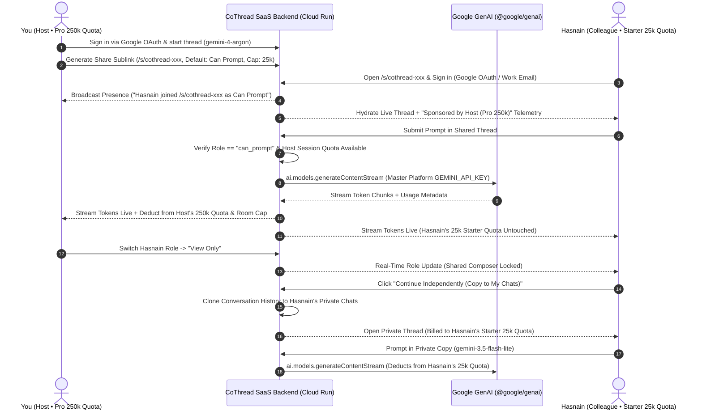

# CoThread — Enterprise Collaborative AI Platform on Google Cloud Run

[](https://cloud.google.com/run)
[](https://www.npmjs.com/package/@google/genai)
[](https://ai.google.dev/)
[](https://cloud.google.com/)
[-D97757?logo=github&logoColor=white)](https://github.com/hasnain-kk)

> **Stop pasting screenshots of AI chats into Slack.**
> **CoThread** is an enterprise SaaS collaborative AI platform (built like `gemini.google.com` and `chatgpt.com`, but natively multiplayer) powered by **Google Cloud Run** and the official **`@google/genai`** SDK.
> Users sign in with **Google OAuth ("Continue with Google")** or **Work Email & Password**—never managing or entering raw API keys. CoThread automatically provisions software-assigned token quotas by subscription tier (`Starter 25k`, `Pro 250k`, `Enterprise 1M`), lets a Host share any live conversation via a secure sublink (`/s/cothread-...`) sponsored by the Host's quota, and lets any colleague click **"Continue Independently (Copy to My Chats)"** to clone the conversation into their private workspace and switch billing to their own account quota.

### 💡 Idea Credits & Team
- **Original Idea & Concept Creator**: **Muhammad Hasnain** ([@hasnain-kk](https://github.com/hasnain-kk) • `hasnainrashi@gmail.com`) — Conceived the core vision of real-time multiplayer AI chat sessions with Host-Sponsored Token Quotas, Google-Docs-style sublink sharing, and seamless independent continuation on personal quotas.
- **Lead Builder & Platform Architect**: **Robina Mirbahar** ([@RobinaMirbahar](https://github.com/RobinaMirbahar)) & **Muhammad Hasnain** ([@hasnain-kk](https://github.com/hasnain-kk))

---

## 1. Problem Statement

Modern software teams, researchers, and enterprise squads rely on consumer/enterprise AI web apps (`gemini.google.com`, `chatgpt.com`) every day, yet **every major AI chat workspace remains strictly single-player**:

1. **Context Fragmentation & Copy-Paste Chaos**: When two engineers debug an architecture issue with AI, one person prompts in isolation and pastes walls of markdown or screenshots into Slack/Teams. Teammates cannot see the live stream or follow-up directly in the same context window.
2. **Subscription Tier & Model Barriers**: A tech lead on a **Pro (`250k tokens`)** or **Enterprise (`1M tokens`)** plan wants to brainstorm with a colleague on a **Starter (`25k tokens`)** plan using frontier models (`gemini-4-argon`), without hitting paywall friction.
3. **Lack of Live Sublink Governance**: Static "share conversation" links in existing platforms only export dead snapshots rather than a live multiplayer thread with role-based permissions (`Can Prompt` vs. `View Only`) and Host-controlled token budgets.

---

## 2. Key Differentiators

### A. Zero-API-Key Enterprise SaaS Experience (`gemini.google.com` / `chatgpt.com` Model)
- **Frictionless Authentication**: Users sign up or sign in using **Google OAuth ("Continue with Google")** or **Work Email & Password**.
- **Platform-Managed Master Key & Software-Assigned Quotas**: End users **never** enter or manage raw Gemini API keys. CoThread's backend securely manages the master `GEMINI_API_KEY` on Google Cloud Run and automatically assigns software-enforced token quotas to each user account based on their subscription tier:
  - **Starter Tier**: `25,000 tokens` (`gemini-3.5-flash-lite`, `gemini-3.8-flash`)
  - **Pro Tier**: `250,000 tokens` (Unlocks `gemini-4-argon` + Host-Sponsored Shared Threads)
  - **Enterprise Tier**: `1,000,000 tokens` (Full model suite + high-capacity team sponsorship)

### B. Real-Time Shared Sessions via Sublinks (`/s/cothread-...`)
- When User A (the Host) clicks **Share**, CoThread generates a dedicated collaborative sublink (`/s/cothread-...`).
- Colleagues who open the sublink sign in with their own CoThread account and join the **exact same live conversation thread** with real-time presence avatars, typing indicators (`"Hasnain is typing a prompt..."`), and synchronized token-by-token Gemini streaming.
- Every prompt and response clearly attributes which authenticated teammate authored the message and which Gemini model responded.

### C. Host-Sponsored Subscription & Token Quota Engine
- **Host-Sponsored Model & Quota Access**: Inside a shared thread (`/s/cothread-...`), all prompts submitted by permitted participants are billed against **User A's (the Host's) software-assigned token quota and subscription tier**. Starter-tier colleagues can collaboratively prompt `gemini-4-argon` inside a Pro/Enterprise Host's shared session.
- **Granular Shared Thread Token Cap**: The Host sets a configurable **Shared Session Token Cap** and monitors a live dual-meter telemetry bar tracking both the **Shared Session Budget** and the **Host's Account Token Quota** (`inputTokens + outputTokens`).
- **Live Role Permissions (`Can Prompt` vs. `View Only`)**: The Host can toggle any colleague between **`Can Prompt`** and **`View Only`** in real time, adjust the shared token cap, or revoke the `/s/cothread-...` sublink at any moment.

### D. "Continue Independently (Copy to My Chats)" — Personal Quota Continuation
- At any point during a live session, any signed-in colleague (including `View Only` participants) can click **"Continue Independently (Copy to My Chats)"**.
- CoThread deep-copies the conversation history up to that moment into a **private thread inside that colleague's own workspace**.
- From that instant forward, the copied thread is **100% independent** of the Host's shared session—all subsequent prompts in the personal copy deduct strictly from **the colleague's own software-assigned account quota** (`Starter 25k` / `Pro 250k` / `Enterprise 1M`) with zero impact on the Host's thread or token balance.

---

## 3. System Architecture

### High-Level Enterprise SaaS Architecture



### Shared Sublink, Host Quota Sponsorship & Independent Copy Sequence



---

## 4. Full Google Cloud Tech Stack

| Layer | Technology | Files & Purpose |
| :--- | :--- | :--- |
| **Database & Rules** | **Cloud Firestore** (`@google-cloud/firestore`) | [`src/db/firestore-db.js`](./src/db/firestore-db.js), [`firestore.rules`](./firestore.rules), [`firestore.indexes.json`](./firestore.indexes.json) — Transactional Host & Personal Token Quota ledger (`users`, `sessions`, `quota_ledger`) |
| **Multi-Agent Orchestration** | **Google Agent Development Kit (ADK)** | [`src/adk/cothread-adk-agent.js`](./src/adk/cothread-adk-agent.js) — `CoThreadADKOrchestrator` with `ContextCompressionSubAgent` (`gemini-3.5-flash-lite`), `QuotaGuardTool`, and `CollaborativeArchitectSubAgent` (`gemini-3.8-flash` / `gemini-4-argon`) |
| **Model Context Protocol** | **CoThread MCP Server (JSON-RPC 2.0)** | [`src/mcp/cothread-mcp-server.js`](./src/mcp/cothread-mcp-server.js) — Exposes 5 MCP tools (`cothread_list_sessions`, `cothread_check_quota`, `cothread_create_shared_session`, `cothread_prompt_adk_agent`, `cothread_fork_to_personal`) over `POST /api/mcp` and `--stdio` |
| **Cloud IDE & Hosting** | **Firebase Studio (`.idx`) + Firebase Hosting** | [`.idx/dev.nix`](./.idx/dev.nix), [`.idx/mcp.json`](./.idx/mcp.json), [`firebase.json`](./firebase.json) — Zero-config Firebase Studio workspace with automatic MCP server registration and Cloud Run rewrites |
| **AI SDK & Models** | **Official `@google/genai` SDK** | [`src/ai/gemini-service.js`](./src/ai/gemini-service.js) — Server-managed `gemini-3.8-flash`, `gemini-4-argon`, and `gemini-3.5-flash-lite` |
| **All-Device UI/UX** | **Responsive Neo-Brutalist Web App** | [`public/index.html`](./public/index.html), [`public/styles.css`](./public/styles.css), [`public/app.js`](./public/app.js), [`public/logo.svg`](./public/logo.svg) — Compatible across phones (`320px+` slide-over drawers, `100dvh`, `viewport-fit=cover`), tablets, laptops, and 4K displays |
| **Cloud Compute** | **Google Cloud Run** + **Cloud Build** | [`Dockerfile`](./Dockerfile), [`cloudbuild.yaml`](./cloudbuild.yaml), [`server.js`](./server.js) — Serverless container deployment on port `8080` |

---

## 5. Local & Firebase Studio Setup Instructions

### Prerequisites
- **Node.js 22+** and `npm` (or open directly in **Firebase Studio** via [`.idx/dev.nix`](./.idx/dev.nix))
- A **Google Gemini API Key** (`GEMINI_API_KEY`) configured once on the backend server (end users never touch API keys)

### Step 1: Install Dependencies
```bash
npm install
```

### Step 2: Configure Backend Environment Variables
Create a `.env` file in the root directory (or export variables in your shell):
```env
GEMINI_API_KEY=your_master_platform_gemini_api_key_here
GOOGLE_CLOUD_PROJECT=your_gcp_project_id
PORT=8080
```

### Step 3: Start CoThread
```bash
npm start
```
Open **`http://localhost:8080`**. Sign in with **Continue with Google** or **Work Email** to provision your Firestore user profile (`users/{uid}`) and launch a live **Shared Session (`/s/cothread-...`)** or **Personal Thread (`/app`)**. Click the **`☁️ Google Stack (Firestore • ADK • MCP)`** badge in the top bar at any time to inspect live Firestore documents, ADK agent traces, and run JSON-RPC 2.0 MCP tools.

---

## 6. Deploying to Google Cloud Run & Firebase Hosting

CoThread includes production-ready [`Dockerfile`](./Dockerfile), [`cloudbuild.yaml`](./cloudbuild.yaml), [`firebase.json`](./firebase.json), and [`firestore.rules`](./firestore.rules) manifests.

### Option A: One-Command Direct Deployment via `gcloud`
```bash
gcloud run deploy cothread \
  --source . \
  --region us-central1 \
  --platform managed \
  --allow-unauthenticated \
  --session-affinity \
  --port 8080 \
  --set-env-vars="GEMINI_API_KEY=YOUR_MASTER_GEMINI_API_KEY,NODE_ENV=production"
```

### Option B: Automated CI/CD via Google Cloud Build
```bash
gcloud builds submit --config cloudbuild.yaml \
  --substitutions=_REGION=us-central1
```

---

## 7. AI Builder Cup 2026 Rubric Alignment

| Evaluation Criterion | How CoThread Excels |
| :--- | :--- |
| **Problem & Impact** | Brings true multiplayer collaboration to consumer/enterprise AI web apps (`gemini.google.com` / `chatgpt.com` paradigm) without screenshot copy-pasting or API key sharing. |
| **Full Google Cloud Stack Integration** | Built end-to-end with **Cloud Firestore** (`firestore.rules`), **Google ADK** (`CoThreadADKOrchestrator`), **Model Context Protocol (MCP)** (`cothread-mcp-server`), **Firebase Studio** (`.idx/dev.nix` & `.idx/mcp.json`), **`@google/genai`**, and **Google Cloud Run**. |
| **Innovation: Software-Assigned Host Quota Engine** | Backend manages the master `GEMINI_API_KEY` and enforces per-account software token quotas (`Starter 25k`, `Pro 250k`, `Enterprise 1M`), allowing Hosts to sponsor guests via `/s/cothread-...` sublinks. |
| **Security & Governance** | Authenticated access (Google OAuth / Work Email), Firestore security rules, revocable `/s/cothread-...` sublinks, configurable session token caps, and live `Can Prompt` / `View Only` role enforcement. |
| **All-Device Responsive Experience** | Works seamlessly on mobile phones (`320px+` slide-over drawers, `100dvh`), tablets, and desktops with real-time presence avatars, transparent token meters, and one-click **"Continue Independently (Copy to My Chats)"**. |

---

## License
Built for the **Google Cloud AI Builder Cup 2026**. MIT License.

